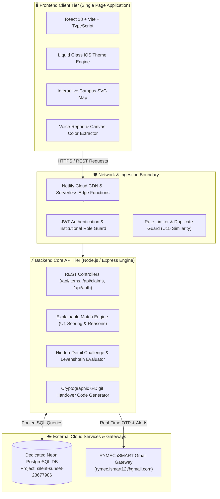
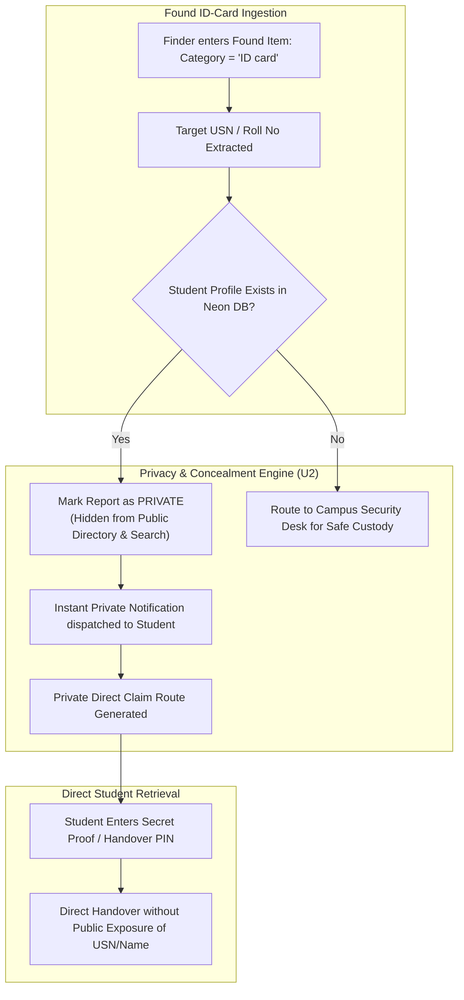
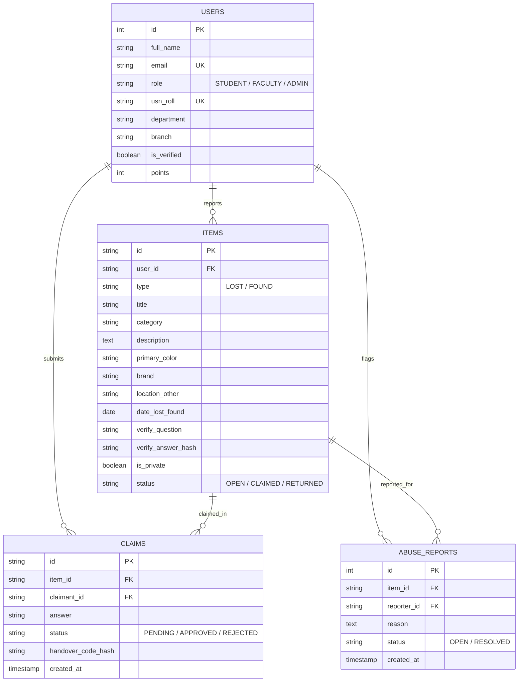

# RYMEC ReClaim-iT: Campus Lost & Found Portal
> **Veerasaiva Vidyavardhaka Sangha's**  
> **Rao Bahadur Y. Mahabaleswarappa Engineering College (RYMEC), Ballari**  
> *Affiliated to Visvesvaraya Technological University (VTU), Belagavi | Approved by AICTE, New Delhi | Accredited by NAAC with 'A+' Grade*

https://rymec-reclaim-it.netlify.app

---

## 🌐 Live Production Website
[](https://app.netlify.com/sites/rymec-reclaim-it/deploys)
[](https://rymec-reclaim-it.netlify.app)
[](https://github.com/nagavakkalagadda/RYMEC_ReClaim-iT_Portal)

### 🔗 **Live Website URL**: [https://rymec-reclaim-it.netlify.app](https://rymec-reclaim-it.netlify.app)

The official live cloud deployment of **RYMEC ReClaim-iT** is hosted 24/7 on Netlify:
👉 **[Access RYMEC ReClaim-iT Live Portal](https://rymec-reclaim-it.netlify.app)**

---

## 🎯 Problem Statement & Mission
On most college campuses, lost phones, student ID cards, wallets, and calculators are communicated through informal WhatsApp messages or paper notices. These posts get buried within hours, lack essential details or photos, cannot be searched, reveal personal phone numbers to strangers, and provide zero verification of ownership before handing over items.

**RYMEC ReClaim-iT** solves this by providing a unified, secure campus recovery portal that:
1. Lets students report Lost/Found items through a structured form with automated colour detection and campus map picking.
2. Automatically pairs Lost and Found reports using an **Explainable Smart Match Engine** that details why items match.
3. Protects ownership through a **Hidden-Detail Challenge Question** and a cryptographic **6-Digit Handover Code**.
4. Safeguards student privacy with **Masked In-App Chat** and **Instant Private ID-Card Notifications**.
5. Gives college administration deep **Prevention Insights & Hotspot Heatmaps** to prevent campus losses.
6. Delivers real-time institutional OTP verification via the official **RYMEC-iSMART** Gateway (`rymec.ismart12@gmail.com`).

---

## 📐 System Architecture & Workflow Block Diagrams

### 1. High-Level System Architecture Block Diagram


---

### 2. End-to-End Item Lifecycle & Secure Handover Block Diagram

```mermaid
flowchart LR
    A["👤 Student / Finder<br>Reports Item (Lost / Found)"] --> B["🔍 Duplicate & Fraud Guard<br>(U15 Similarity Check)"]
    B --> C["⚡ Explainable Match Engine<br>(Score >= 50% Threshold)"]
    C -->|Auto-Pairing| D["🔔 Real-Time Match Alerts<br>(Email & In-App Notification)"]
    D --> E["🔐 Ownership Verification<br>(Hidden Challenge Question)"]
    E -->|Answer Verified| F["🔑 6-Digit Handover Code<br>(SHA-256 Hashed & Timestamped)"]
    F --> G["🏢 Physical Exchange<br>(Security Kiosk / Safe Drop Desk)"]
    G --> H["✅ Handover Confirmed<br>(Status: RETURNED)"]
    H --> I["🏆 Citation & Trust Points<br>(+20 Points & Badge Awarded)"]
```


---

### 3. Institutional ID-Card Instant Notification & Privacy Block Diagram


---

### 4. Database Entity-Relationship Block Diagram


---

## 💎 Liquid Glass iOS Design System
The entire portal is built with an Apple-like Liquid Glass interface:
- **Translucent Refractive Layers**: `backdrop-filter: blur(24px) saturate(180%) brightness(1.05)` with specular borders and inner highlights.
- **Dynamic Colored Mesh Background**: 5 large color blobs (indigo, violet, cyan, pink, amber) drifting with smooth CSS keyframes, blended over the official aerial view of the RYMEC campus (`/images/rymec-campus.png`).
- **Status Colors**: Lost (Rose `#f43f5e`), Found (Emerald `#10b981`), Matched (Amber `#f59e0b`), Claimed (Sky `#0284c7`), Returned (Violet `#8b5cf6`).
- **Interactive SVG Campus Map**: 10 distinct RYMEC campus zones (Library, Canteen, Main Gate, Bus Bay, Mechanical Block, Electrical Block, CS & IT Labs, Auditorium, Sports Ground, Hostel Block).
- **Light & Dark Mode**: Persistent theme toggle with seamless contrast adjustment.

---

## 🚀 Quick Start & Launch

### Prerequisites
- Node.js (v18+)

### Running Preview Services
To start both the Backend API (port 5000) and the Frontend Live Preview (port 5173) simultaneously:

```bash
# Using root preview script
npm run dev

# Or directly on Windows
start.bat
```

Open your browser at: **`http://localhost:5173`**

### Running Unit Tests
To verify the pure Explainable Match Engine:
```bash
npm run test
```

---

## 🛡️ Authentication & Account Settings
- **Email-Based Sign-In**: Login using your College or Personal Email ID (`student@rymec.edu.in` or `your.name@gmail.com`).
- **Real OTP Email Verification**: 6-digit authentication codes dispatched directly from `rymec.ismart12@gmail.com`.
- **Institutional Roles**: Distinct academic workflows for **Student** and **Faculty Member**.
- **Accommodation Profiling**: Categorized into **Day Scholar**, **PG**, or **Hostel**.
- **Academic Department Selection**: Computer Science, ECE, EEE, Mechanical, Civil, ISE, and AI & ML.
- **Account Settings in Dashboard**:
  - Live profile information management (Legal Name, Department, Section, Academic Year, Accommodation).
  - Security & Password change portal with bcrypt cryptographic hashing.
  - Direct Grievance & Helpdesk escalation to `rymec.ismart12@gmail.com`.

---

## 📋 Complete Feature-to-File Checklist

### Core Features (C1 – C9)
- **C1: Register / Login / Logout**: `backend/routes/auth.js`, `frontend/src/pages/Login.tsx`, `frontend/src/pages/Register.tsx`, `frontend/src/context/AuthContext.tsx`
- **C2: Structured Report Form**: `frontend/src/pages/Report.tsx`, `backend/routes/items.js`
- **C3: Browse & Search with Status Badges**: `frontend/src/pages/Browse.tsx`, `frontend/src/components/items/ItemCard.tsx`
- **C4: Item Detail & Timeline**: `frontend/src/pages/ItemDetail.tsx`, `backend/lib/db.js`
- **C5: Status Lifecycle**: `backend/routes/items.js`, `backend/routes/handover.js`
- **C6: My Dashboard (7 Tabs including Account Settings)**: `frontend/src/pages/Dashboard.tsx`
- **C7: Realtime Notifications & Email Logger**: `backend/lib/mailer.js`, `backend/routes/notifications.js`, `frontend/src/components/layout/Navbar.tsx`
- **C8: Admin Dashboard**: `frontend/src/pages/AdminDashboard.tsx`, `backend/routes/admin.js`
- **C9: Glass Skeletons, Toasts & 404**: `frontend/src/context/ToastContext.tsx`, `frontend/src/pages/NotFound.tsx`, `frontend/src/index.css`

### The 18 Unique Features (U1 – U18)
- **U1: Explainable Smart Match Engine**: `backend/lib/matching.js`, `backend/tests/matching.test.js`, `frontend/src/components/items/MatchRing.tsx`
- **U2: ID-Card Instant Notify**: `backend/routes/items.js`, `frontend/src/pages/Report.tsx`
- **U3: Handover Code & Custody Log**: `backend/lib/db.js`, `backend/routes/handover.js`, `frontend/src/pages/Handover.tsx`
- **U4: Hidden-Detail Challenge Question**: `backend/lib/db.js` (`levenshteinDistance`), `frontend/src/pages/ItemDetail.tsx`, `frontend/src/pages/Dashboard.tsx`
- **U5: Masked In-App Chat**: `backend/routes/chat.js`, `frontend/src/components/chat/MaskedChat.tsx`
- **U6: Smart Watchlist (Saved Alerts)**: `backend/routes/watchlist.js`, `frontend/src/pages/Dashboard.tsx`
- **U7: Photo-First Canvas Dominant Colour**: `frontend/src/lib/colorExtractor.ts`, `frontend/src/pages/Report.tsx`
- **U8: Voice Report Assistant**: `frontend/src/lib/voiceParser.ts`, `frontend/src/pages/Report.tsx`
- **U9: Location QR Posters & /near route**: `frontend/src/pages/NearLocation.tsx`, `frontend/src/pages/AdminPosters.tsx`
- **U10: Interactive Campus Map & Heatmap**: `frontend/src/components/campus/CampusMapSvg.tsx`, `frontend/src/pages/AdminDashboard.tsx`
- **U11: Prevention Insights Dashboard**: `backend/routes/admin.js`, `frontend/src/pages/AdminDashboard.tsx`
- **U12: Trust Score, Points, Badges & Citation Certificate**: `backend/routes/leaderboard.js`, `frontend/src/pages/Leaderboard.tsx`, `frontend/src/pages/Certificate.tsx`
- **U13: WhatsApp-Friendly Share Cards**: `frontend/src/components/items/ShareModal.tsx`
- **U14: Anonymous Drop-Off Mode**: `backend/routes/items.js`, `frontend/src/pages/Report.tsx`
- **U15: Duplicate & Fraud Guard**: `backend/lib/duplicateGuard.js`, `backend/routes/claims.js`
- **U16: Auto-Expiry, Reminders & Donation**: `backend/routes/maintenance.js`, `frontend/src/pages/AdminDashboard.tsx`
- **U17: Installable PWA with Push**: `frontend/public/manifest.json`, `frontend/public/sw.js`, `frontend/public/offline.html`
- **U18: Liquid Glass Interface**: `frontend/src/index.css`, `frontend/tailwind.config.js`, `frontend/src/components/layout/LiquidBackground.tsx`

---

## 🏛️ Comprehensive Documentation
Detailed project documentation is available in the `/docs` directory:
- [Database ER Diagram (`/docs/ER_DIAGRAM.md`)](file:///C:/Users/V.NAGA%20PHANENDRA/.gemini/antigravity/scratch/rymec-reclaim-it/docs/ER_DIAGRAM.md)
- [Use Cases & Walkthroughs (`/docs/USE_CASES.md`)](file:///C:/Users/V.NAGA%20PHANENDRA/.gemini/antigravity/scratch/rymec-reclaim-it/docs/USE_CASES.md)
- [Data Flow Diagrams (`/docs/DATA_FLOW.md`)](file:///C:/Users/V.NAGA%20PHANENDRA/.gemini/antigravity/scratch/rymec-reclaim-it/docs/DATA_FLOW.md)
- [Test Cases Matrix (`/docs/TEST_CASES.md`)](file:///C:/Users/V.NAGA%20PHANENDRA/.gemini/antigravity/scratch/rymec-reclaim-it/docs/TEST_CASES.md)

---

## 👥 Project Team & Contributors
This project was architected, engineered, and evaluated by final-year students of the **Department of Computer Science & Engineering**, **Rao Bahadur Y. Mahabaleswarappa Engineering College (RYMEC)**, Ballari.

| Contributor | GitHub Profile | Role & Primary Responsibilities | Institutional Department |
| :--- | :--- | :--- | :--- |
|  <br> **Karthik H** | [@karthikhkarthik92-art](https://github.com/karthikhkarthik92-art) | **Core Contributor — Algorithmic Match Engine & Custody Architecture** <br> • Pure explainable scoring engine (`lib/matching.ts`) <br> • 6-Digit SHA-256 handover verification & QR lifecycle <br> • Custody timeline & custody events logging | Computer Science & Engineering, RYMEC |
|  <br> **Akash Gouda** | [@akash-gouda](https://github.com/akash-gouda) | **Core Contributor — Full-Stack Integration & Database Services** <br> • Express REST APIs & Supabase PostgreSQL integration <br> • Private ID-card instant resolution & masking <br> • Watchlist triggers & notification services | Computer Science & Engineering, RYMEC |
|  <br> **Siddharth P C** | [@siddharthpc0925](https://github.com/siddharthpc0925) | **Core Contributor — UI/UX Design & Liquid Glass Components** <br> • Apple iOS Liquid Glass UI system & animations <br> • Pebble pill filters, responsive item directory & cards <br> • Photo dominant color extractor & canvas quantization | Computer Science & Engineering, RYMEC |
|  <br> **Veeresh Mugali** | [@veereshmugali89-bit](https://github.com/veereshmugali89-bit) | **Core Contributor — Verification, QA & Security Desk Portal** <br> • Security desk handover verification & admin core <br> • Hidden-detail challenge question & Levenshtein matching <br> • End-to-end testing, role guards & abuse reporting | Computer Science & Engineering, RYMEC |

---

### 🏛️ Institutional Credit & Governance
**Rao Bahadur Y. Mahabaleswarappa Engineering College (RYMEC)**  
*Affiliated to Visvesvaraya Technological University (VTU), Belagavi • Approved by AICTE, New Delhi • Accredited by NAAC with 'A+' Grade*  
**Campus:** Cantonment, Ballari — 583 104, Karnataka, India  
**Parent Management:** Veerasaiva Vidyavardhaka Sangha, Ballari (Estd. 1916 / College Estd. 1980)  
**Official Email Gateway:** `rymec.ismart12@gmail.com`
