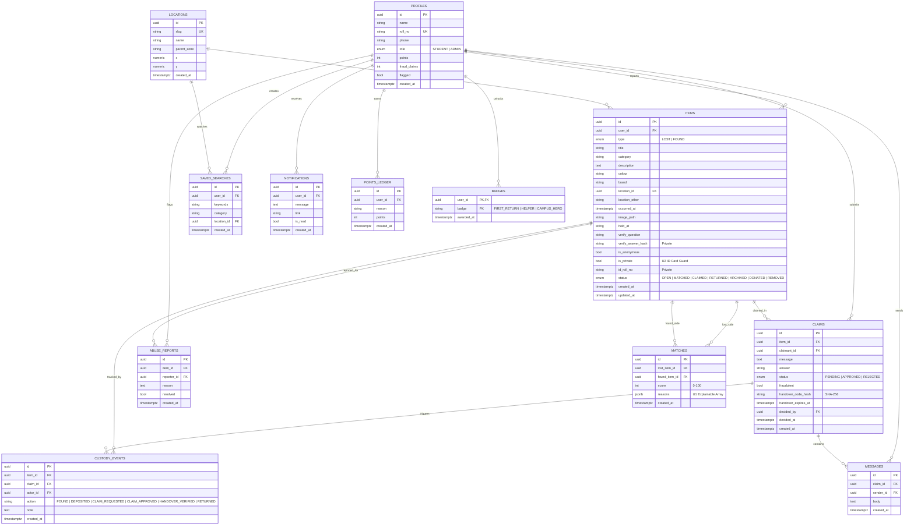

# RYMEC ReClaim-iT: Database Entity Relationship (ER) Diagram

This diagram documents the complete relational schema implemented for the RYMEC Campus Lost & Found Portal, including primary keys, foreign key relationships, cascade constraints, and sensitive data protection fields.

### Public View Layer: `public_items`
For data safety and student privacy, all client-facing browse queries read through the SQL view `public_items`:
1. Filters out records where `is_private = TRUE` (such as discovered ID cards awaiting private claim).
2. Filters out records where `status = 'REMOVED'`.
3. Strips `verify_answer_hash` and `id_roll_no` so hashes are never exposed over the network.
4. Replaces `user_id` and `reporter_name` with `'Anonymous Student'` when `is_anonymous = TRUE`.
