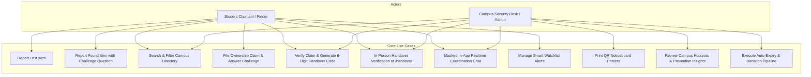

# RYMEC ReClaim-iT: Use Cases & Actor Scenarios

## Detailed Actor Walkthroughs

### 1. Student A (Lost Item Owner)
- **Step 1**: Discovers their black wallet is missing after a compiler lab in the Central Library.
- **Step 2**: Signs in to RYMEC ReClaim-iT and submits a structured Lost Item report with category, location (Central Library), and photo.
- **Step 3**: The Explainable Match Engine scans active found reports and instantly flags a 90% match.
- **Step 4**: Student A receives a push/in-app notification, views the matching found wallet, answers the finder's verification question ("What color is the Metro card and last digits on receipt?"), and submits their claim.
- **Step 5**: Once approved, Student A receives a 6-digit handover code and QR.
- **Step 6**: Student A meets Student B at the library entrance, shows the handover QR, confirms return, and receives +2 Good Samaritan points.

### 2. Student B (Finder / Good Samaritan)
- **Step 1**: Discovers a black wallet on table #12 in the Central Library.
- **Step 2**: Opens the portal, takes a photo (auto-extracting the color 'Black' via canvas sampling), selects the location from the interactive campus map, and sets a private verification question and answer.
- **Step 3**: Receives a notification when Student A claims it; reviews Student A's answer side-by-side with a close-match verification badge.
- **Step 4**: Clicks "Approve & Issue Handover Code". Coordinates meeting time via masked chat without revealing phone numbers.
- **Step 5**: Enters the 6-digit code at `/handover`. Case status permanently changes to `RETURNED`. Student B receives +20 trust points and unlocks the `FIRST_RETURN` badge!

### 3. Campus Security Desk (Admin)
- **Step 1**: Accesses the Admin Core to monitor active lost-and-found operations across all 10 campus zones.
- **Step 2**: Reviews the Hotspot Heatmap to identify peak loss zones (e.g. Canteen at lunch hour, Bus Bay in the evening).
- **Step 3**: Reads automated Prevention Insights to plan physical lost-property drop boxes.
- **Step 4**: Prints high-resolution A4 noticeboard posters with QR codes for campus noticeboards.
- **Step 5**: Periodically runs the maintenance pipeline to auto-remind finders at 30 days, auto-archive at 60 days, and donate unclaimed property after 90 days.
